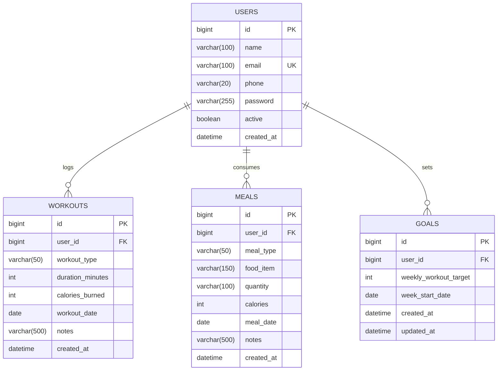

# FitLog — Database Documentation & Setup Guide

This document describes the database design, schema, relational constraints, indexing strategy, and setup instructions for the **FitLog — Personal Workout and Calorie Tracker** system.

---

## 1. Database Overview

- **DBMS**: MySQL 8.0+
- **Database Name**: `fitlog_db`
- **ORM / Persistence**: Spring Data JPA / Hibernate
- **DDL Strategy**: `spring.jpa.hibernate.ddl-auto=update`
- **Character Encoding**: `utf8mb4`
- **Collation**: `utf8mb4_unicode_ci`

---

## 2. Entity Relationship Overview



---

## 3. Table Schema & Column Specifications

### Table 1: `users`
| Column | Type | Constraints | Description |
|---|---|---|---|
| `id` | `BIGINT` | PRIMARY KEY, AUTO_INCREMENT | Unique user identifier |
| `name` | `VARCHAR(100)` | NOT NULL | User's full name |
| `email` | `VARCHAR(100)` | NOT NULL, UNIQUE, INDEX | User login and contact email |
| `phone` | `VARCHAR(20)` | NULLABLE | Contact telephone |
| `password` | `VARCHAR(255)` | NULLABLE | Authentication credential |
| `active` | `BOOLEAN` | NOT NULL, DEFAULT TRUE | User account active flag |
| `created_at` | `DATETIME` | NOT NULL | Timestamp when account was created |

### Table 2: `workouts`
| Column | Type | Constraints | Description |
|---|---|---|---|
| `id` | `BIGINT` | PRIMARY KEY, AUTO_INCREMENT | Unique workout record identifier |
| `user_id` | `BIGINT` | NOT NULL, FOREIGN KEY (`users.id`) | Owning user ID |
| `workout_type` | `VARCHAR(50)` | NOT NULL | Enum: `RUNNING`, `WALKING`, `CYCLING`, `GYM`, `YOGA`, `SWIMMING`, `OTHER` |
| `duration_minutes` | `INT` | NOT NULL, CHECK > 0 | Exercise duration in minutes |
| `calories_burned` | `INT` | NOT NULL, CHECK >= 0 | Estimated calories burned (**Rule 1**) |
| `workout_date` | `DATE` | NOT NULL, INDEX | Date workout occurred |
| `notes` | `VARCHAR(500)` | NULLABLE | Session observations / details |
| `created_at` | `DATETIME` | NOT NULL | Timestamp when entry was logged |

### Table 3: `meals`
| Column | Type | Constraints | Description |
|---|---|---|---|
| `id` | `BIGINT` | PRIMARY KEY, AUTO_INCREMENT | Unique meal record identifier |
| `user_id` | `BIGINT` | NOT NULL, FOREIGN KEY (`users.id`) | Owning user ID |
| `meal_type` | `VARCHAR(50)` | NOT NULL | Enum: `BREAKFAST`, `LUNCH`, `DINNER`, `SNACK`, `OTHER` |
| `food_item` | `VARCHAR(150)` | NOT NULL | Description of food/drink |
| `quantity` | `VARCHAR(100)` | NULLABLE | Serving quantity (e.g. `1 bowl`, `2 slices`) |
| `calories` | `INT` | NOT NULL, CHECK >= 0 | Calories consumed (**Rule 1**) |
| `meal_date` | `DATE` | NOT NULL, INDEX | Date meal consumed |
| `notes` | `VARCHAR(500)` | NULLABLE | Meal preparation or ingredient notes |
| `created_at` | `DATETIME` | NOT NULL | Timestamp when entry was logged |

### Table 4: `goals`
| Column | Type | Constraints | Description |
|---|---|---|---|
| `id` | `BIGINT` | PRIMARY KEY, AUTO_INCREMENT | Unique weekly goal identifier |
| `user_id` | `BIGINT` | NOT NULL, FOREIGN KEY (`users.id`) | Owning user ID |
| `weekly_workout_target` | `INT` | NOT NULL, CHECK > 0 | Target workout count for the week (**Rule 4**) |
| `week_start_date` | `DATE` | NOT NULL, INDEX | Monday / Start date of target week |
| `created_at` | `DATETIME` | NOT NULL | Timestamp when goal was created |
| `updated_at` | `DATETIME` | NULLABLE | Timestamp when goal target was updated |

---

## 4. Indexing & Optimization Strategy

1. **`idx_user_email` (`users.email`)**: Speeds up lookups when authenticating or checking email uniqueness.
2. **`idx_workout_user_date` (`workouts.user_id, workout_date`)**: Composite index optimizing daily calorie queries (`GET /api/users/{userId}/summary/daily?date=...`) and weekly ranges.
3. **`idx_meal_user_date` (`meals.user_id, meal_date`)**: Composite index accelerating date-based meal aggregations.
4. **`idx_goal_user_week` (`goals.user_id, week_start_date`)**: Optimizes single-lookup weekly goal queries.

---

## 5. MySQL Setup Instructions

### Step 1: Install MySQL Server (if not installed)
```bash
# Ubuntu/Debian
sudo apt update
sudo apt install mysql-server -y
sudo systemctl start mysql

# macOS (Homebrew)
brew install mysql
brew services start mysql

# Windows
# Download and run MySQL Community Server MSI Installer
```

### Step 2: Create Database (Automatic or Manual)
The application JDBC URL is configured with `createDatabaseIfNotExist=true`:
```properties
spring.datasource.url=jdbc:mysql://localhost:3306/fitlog_db?createDatabaseIfNotExist=true&useSSL=false&allowPublicKeyRetrieval=true&serverTimezone=UTC
```
If you wish to create it manually via MySQL CLI:
```sql
CREATE DATABASE fitlog_db;
```

### Step 3: Configure Credentials
Edit `src/main/resources/application.properties` or provide environment variables:
```bash
export DB_USERNAME=root
export DB_PASSWORD=your_password
```
Alternatively, edit:
```properties
spring.datasource.username=root
spring.datasource.password=root
```
