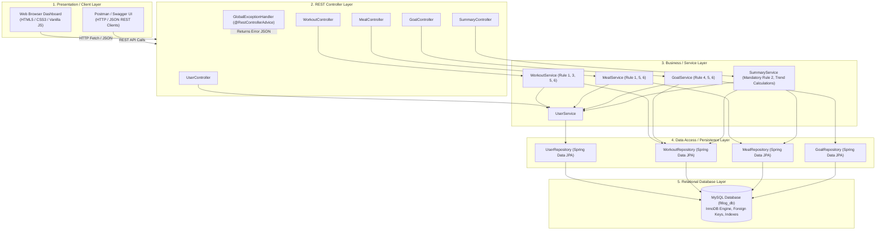

# FitLog — System Architecture & Design Documentation

## 1. High-Level Multi-Tier Architecture

FitLog follows a strict **Layered (N-Tier) Architecture** with clear Separation of Concerns (SoC). Each layer is decoupled and has designated responsibilities.

---

## 2. Layer Responsibilities & Viva Explanation

### 1. Presentation Layer (Frontend)
- **Technology**: Semantic HTML5, CSS3 with glassmorphism aesthetics, Vanilla JavaScript using the Fetch API.
- **Responsibility**: Provides a responsive user experience for logging workouts and meals, visualizing daily calorie balances, viewing weekly trends, tracking goal progress, and running negative test demonstrations.
- **Viva Point**: No heavy frontend frameworks (such as React or Angular) are used. The frontend is lightweight, zero-dependency, and interacts with the backend strictly via standardized REST JSON APIs.

### 2. Controller Layer (`@RestController`)
- **Components**: `UserController`, `WorkoutController`, `MealController`, `GoalController`, `SummaryController`.
- **Responsibility**: Handles HTTP requests, parses path parameters and query strings, applies Bean Validation (`@Valid`), and returns standard HTTP responses (`ResponseEntity`) with appropriate status codes (`200 OK`, `201 CREATED`, `204 NO CONTENT`).
- **Separation of Concerns**: Controllers contain **zero** business logic. They solely delegate processing to the service layer.

### 3. Service Layer (`@Service`, `@Transactional`)
- **Components**: `UserService`, `WorkoutService`, `MealService`, `GoalService`, `SummaryService`.
- **Responsibility**: **Core Business Rules Engine**.
  - **Rule 1**: Validates non-negative calories for both workouts and meals.
  - **Rule 2**: Rejects weekly summary requests when no relevant workout or meal entries exist for that week.
  - **Rule 3 & 4**: Validates positive workout duration and weekly goal targets.
  - **Rule 5 & 6**: Enforces date constraints and verifies user existence.
  - **Dynamic Calculations**: Computes net calorie balances (`consumed - burned`) and aggregates 7-day trend summaries.

### 4. Data Access Layer (`@Repository`)
- **Components**: `UserRepository`, `WorkoutRepository`, `MealRepository`, `GoalRepository`.
- **Technology**: Spring Data JPA extending `JpaRepository<T, ID>`.
- **Responsibility**: Encapsulates database operations, providing automatic implementation for CRUD methods, derived query methods (e.g. `findByUserIdAndWorkoutDateBetween`), and index-backed query execution.

### 5. Database Layer (MySQL)
- **Database**: `fitlog_db`.
- **Responsibility**: Persistent storage, ACID transaction compliance, referential integrity via Foreign Keys with `ON DELETE CASCADE`, check constraints, and performance indexes.

### 6. Cross-Cutting Exception Handling (`@RestControllerAdvice`)
- **Component**: `GlobalExceptionHandler`.
- **Responsibility**: Intercepts `ResourceNotFoundException`, `BusinessRuleException`, `MethodArgumentNotValidException`, and data integrity errors, translating them into structured, secure JSON error representations without leaking stack traces.
