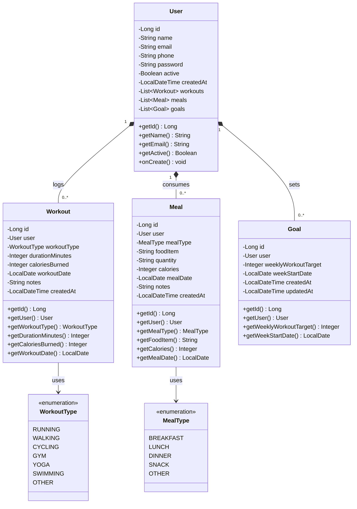

# FitLog — Class Diagram Documentation

This document specifies the object-oriented structure of FitLog, including Domain Entities, Controllers, Services, Repositories, and their relationships.

---

## 1. Domain Entities & Relationships

---

## 2. Complete Architecture Class Diagram

```mermaid
classDiagram
    direction TB

    %% Controllers
    class UserController {
        -UserService userService
        +createUser(CreateUserRequest) ResponseEntity
        +getAllUsers() ResponseEntity
        +getUserById(Long) ResponseEntity
        +updateUser(Long, UpdateUserRequest) ResponseEntity
        +deleteUser(Long) ResponseEntity
    }

    class WorkoutController {
        -WorkoutService workoutService
        +createWorkout(CreateWorkoutRequest) ResponseEntity
        +getAllWorkouts() ResponseEntity
        +getWorkoutById(Long) ResponseEntity
        +updateWorkout(Long, UpdateWorkoutRequest) ResponseEntity
        +deleteWorkout(Long) ResponseEntity
        +getUserWorkouts(Long, LocalDate) ResponseEntity
    }

    class MealController {
        -MealService mealService
        +createMeal(CreateMealRequest) ResponseEntity
        +getAllMeals() ResponseEntity
        +getMealById(Long) ResponseEntity
        +updateMeal(Long, UpdateMealRequest) ResponseEntity
        +deleteMeal(Long) ResponseEntity
        +getUserMeals(Long, LocalDate) ResponseEntity
    }

    class GoalController {
        -GoalService goalService
        +createGoal(CreateGoalRequest) ResponseEntity
        +getAllGoals() ResponseEntity
        +getGoalById(Long) ResponseEntity
        +updateGoal(Long, UpdateGoalRequest) ResponseEntity
        +deleteGoal(Long) ResponseEntity
        +getUserGoals(Long, LocalDate) ResponseEntity
        +getGoalProgress(Long, LocalDate) ResponseEntity
    }

    class SummaryController {
        -SummaryService summaryService
        +getDailySummary(Long, LocalDate) ResponseEntity
        +getWeeklySummary(Long, LocalDate) ResponseEntity
        +getWeeklyWorkoutTrend(Long, LocalDate) ResponseEntity
    }

    %% Services
    class UserService {
        -UserRepository userRepository
        +createUser(CreateUserRequest) UserResponse
        +getAllUsers() List~UserResponse~
        +getUserById(Long) UserResponse
        +getUserEntityById(Long) User
        +updateUser(Long, UpdateUserRequest) UserResponse
        +deleteUser(Long) void
    }

    class WorkoutService {
        -WorkoutRepository workoutRepository
        -UserService userService
        +createWorkout(CreateWorkoutRequest) WorkoutResponse
        +getAllWorkouts() List~WorkoutResponse~
        +getWorkoutById(Long) WorkoutResponse
        +getWorkoutsByUserId(Long) List~WorkoutResponse~
        +getWorkoutsByUserIdAndDate(Long, LocalDate) List~WorkoutResponse~
        +updateWorkout(Long, UpdateWorkoutRequest) WorkoutResponse
        +deleteWorkout(Long) void
        -validateWorkoutData(Integer, Integer, LocalDate) void
    }

    class MealService {
        -MealRepository mealRepository
        -UserService userService
        +createMeal(CreateMealRequest) MealResponse
        +getAllMeals() List~MealResponse~
        +getMealById(Long) MealResponse
        +getMealsByUserId(Long) List~MealResponse~
        +getMealsByUserIdAndDate(Long, LocalDate) List~MealResponse~
        +updateMeal(Long, UpdateMealRequest) MealResponse
        +deleteMeal(Long) void
        -validateMealData(Integer, LocalDate, String) void
    }

    class GoalService {
        -GoalRepository goalRepository
        -WorkoutRepository workoutRepository
        -UserService userService
        +createGoal(CreateGoalRequest) GoalResponse
        +getAllGoals() List~GoalResponse~
        +getGoalById(Long) GoalResponse
        +getGoalsByUserId(Long) List~GoalResponse~
        +getGoalByUserIdAndWeek(Long, LocalDate) GoalResponse
        +updateGoal(Long, UpdateGoalRequest) GoalResponse
        +deleteGoal(Long) void
        +getGoalProgress(Long, LocalDate) GoalProgressResponse
        -validateGoalData(Integer, LocalDate) void
    }

    class SummaryService {
        -WorkoutRepository workoutRepository
        -MealRepository mealRepository
        -UserService userService
        +getDailyCalorieSummary(Long, LocalDate) DailySummaryResponse
        +getWeeklySummary(Long, LocalDate) WeeklySummaryResponse
        +getWeeklyWorkoutTrend(Long, LocalDate) WeeklyWorkoutTrendResponse
    }

    %% Repositories
    class UserRepository {
        <<interface>>
        +findByEmail(String) Optional~User~
        +existsByEmail(String) boolean
        +findByActiveTrue() List~User~
    }

    class WorkoutRepository {
        <<interface>>
        +findByUserId(Long) List~Workout~
        +findByUserIdAndWorkoutDate(Long, LocalDate) List~Workout~
        +findByUserIdAndWorkoutDateBetween(Long, LocalDate, LocalDate) List~Workout~
    }

    class MealRepository {
        <<interface>>
        +findByUserId(Long) List~Meal~
        +findByUserIdAndMealDate(Long, LocalDate) List~Meal~
        +findByUserIdAndMealDateBetween(Long, LocalDate, LocalDate) List~Meal~
    }

    class GoalRepository {
        <<interface>>
        +findByUserIdAndWeekStartDate(Long, LocalDate) Optional~Goal~
        +findByUserId(Long) List~Goal~
    }

    %% Controller -> Service linkages
    UserController --> UserService
    WorkoutController --> WorkoutService
    MealController --> MealService
    GoalController --> GoalService
    SummaryController --> SummaryService

    %% Service -> Repository & Service linkages
    UserService --> UserRepository
    WorkoutService --> WorkoutRepository
    WorkoutService --> UserService
    MealService --> MealRepository
    MealService --> UserService
    GoalService --> GoalRepository
    GoalService --> WorkoutRepository
    GoalService --> UserService
    SummaryService --> WorkoutRepository
    SummaryService --> MealRepository
    SummaryService --> UserService
```

