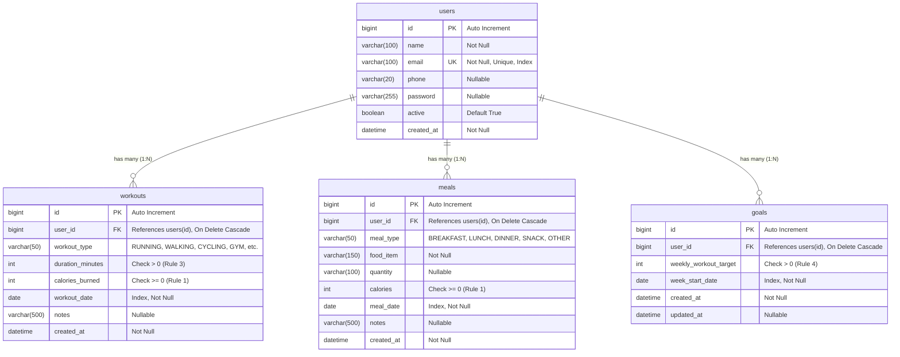

# FitLog — Database Schema & Entity Relationship Documentation

This document describes the relational model, tables, attributes, primary/foreign keys, and integrity rules implemented in the MySQL `fitlog_db` database.

---

## 1. Entity-Relationship Diagram (ERD)

---

## 2. Relational Integrity & Viva Highlights

### 1. Primary & Foreign Keys
- `users.id`: Primary Key for the user entity.
- `workouts.user_id`: Foreign Key referencing `users(id)` with `ON DELETE CASCADE`. If a user is removed, all their workout records are automatically cleaned up to prevent orphaned rows.
- `meals.user_id`: Foreign Key referencing `users(id)` with `ON DELETE CASCADE`.
- `goals.user_id`: Foreign Key referencing `users(id)` with `ON DELETE CASCADE`.

### 2. Constraints & Validation Defense-in-Depth
- **Calories Must Be Non-Negative (Rule 1)**:
  - Database check constraints: `chk_workout_calories (calories_burned >= 0)` and `chk_meal_calories (calories >= 0)`.
  - Service-layer validation: `WorkoutService` and `MealService` check and reject negative numbers before database interaction.
  - Bean Validation: `@PositiveOrZero` on DTOs.
- **Duration Must Be Positive (Rule 3)**:
  - `chk_workout_duration (duration_minutes > 0)`.
- **Target Must Be Positive (Rule 4)**:
  - `chk_goal_target (weekly_workout_target > 0)`.

### 3. Indexing Strategy
- `idx_user_email`: Speeds up lookups on user email during creation and login.
- `idx_workout_user_date` (`user_id, workout_date`): Drastically optimizes daily calorie aggregation queries (`GET /api/users/{userId}/summary/daily?date=...`).
- `idx_meal_user_date` (`user_id, meal_date`): Accelerates date-range queries for meals.
- `idx_goal_user_week` (`user_id, week_start_date`): Accelerates weekly target and progress checks.
